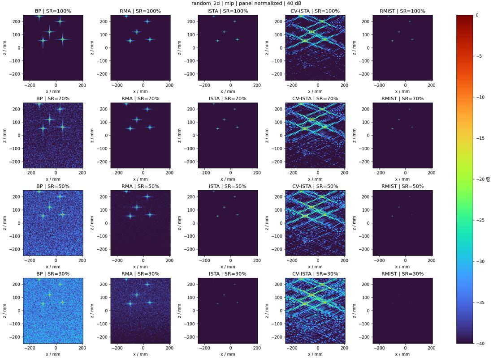
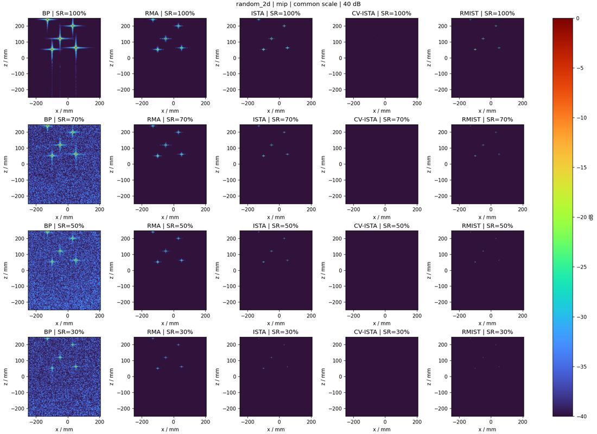
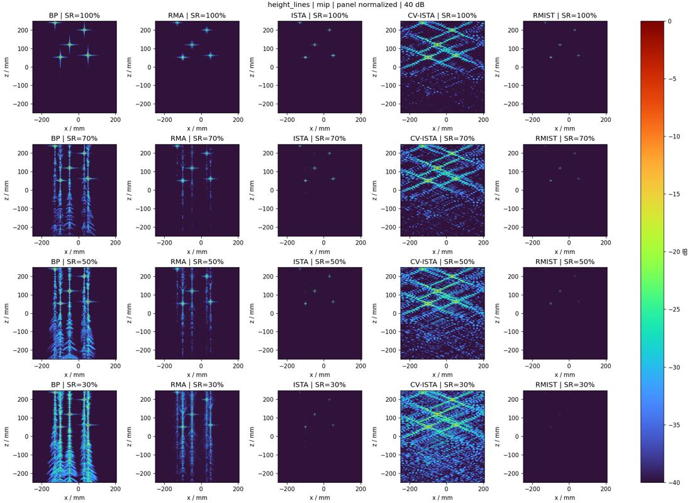
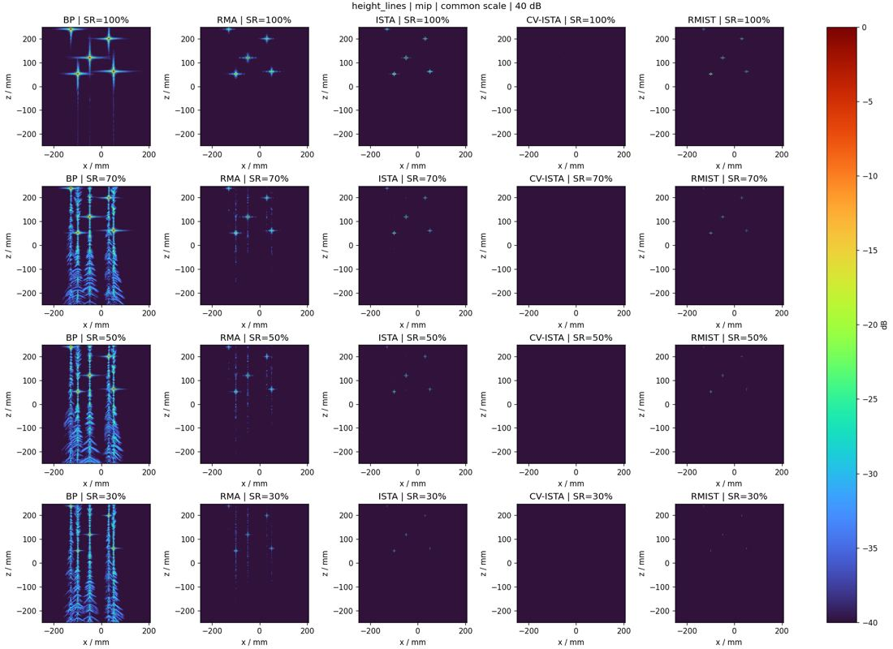

# Baseline review evidence — 2026-10-24

**Implemented; 40 full-size point-simulation rows complete. Actual Hammer is
BLOCKED_MISSING_DATA.** Tests: 46 passed, 3 skipped (external capture / CUDA).

The five methods share the explicit 3DRIED configuration, physical aperture,
range bins and masks. These are RM-model point simulations, not real Hammer
images. BP is a spherical-wave slice approximation; CV-ISTA is classical
masked complex-L1 ISTA with a fixed, unproved-converged 100-step budget.
RMIST uses the original M6 scalars without retraining. Do not rank algorithms
from these initial panels without addressing the documented differences.

- [Implementation report](../../../docs/BASELINE_IMPLEMENTATION_REPORT.md)
- [Exact algorithm definitions](../../../BASELINE_SPEC.md)
- [Shared parameter explanation](../../../docs/BASELINE_PARAMETERS.md)
- [40-row metrics CSV](summary_metrics.csv)
- [CV-ISTA objective summaries](cv_ista_objective_summary.csv)
- [Sampling counts and hashes](sampling_manifest.json)
- [Actual real-data status](real_status.json)
- [Test / repeatability evidence](verification.txt)

## Random 2-D aperture positions

Per-panel normalization shows morphology. Every panel uses its own peak.

Common scale uses the same full-data RMA reference peak, preserving amplitude
changes. Algorithm gain/model differences still need to be considered.

[Sampling masks](random_2d_sampling_masks.jpg) ·
[3-D point clouds](random_2d_volume_3d.jpg)

## Random height lines

Each retained height includes all 407 horizontal positions.

[Sampling masks](height_lines_sampling_masks.jpg) ·
[3-D point clouds](height_lines_volume_3d.jpg)

Full-resolution figures and complete complex volumes are regenerated by the
runbook command. JPEGs here are compact review previews. Ground-truth metrics
are restricted to point simulations; no real RMA image is a supervised label.
